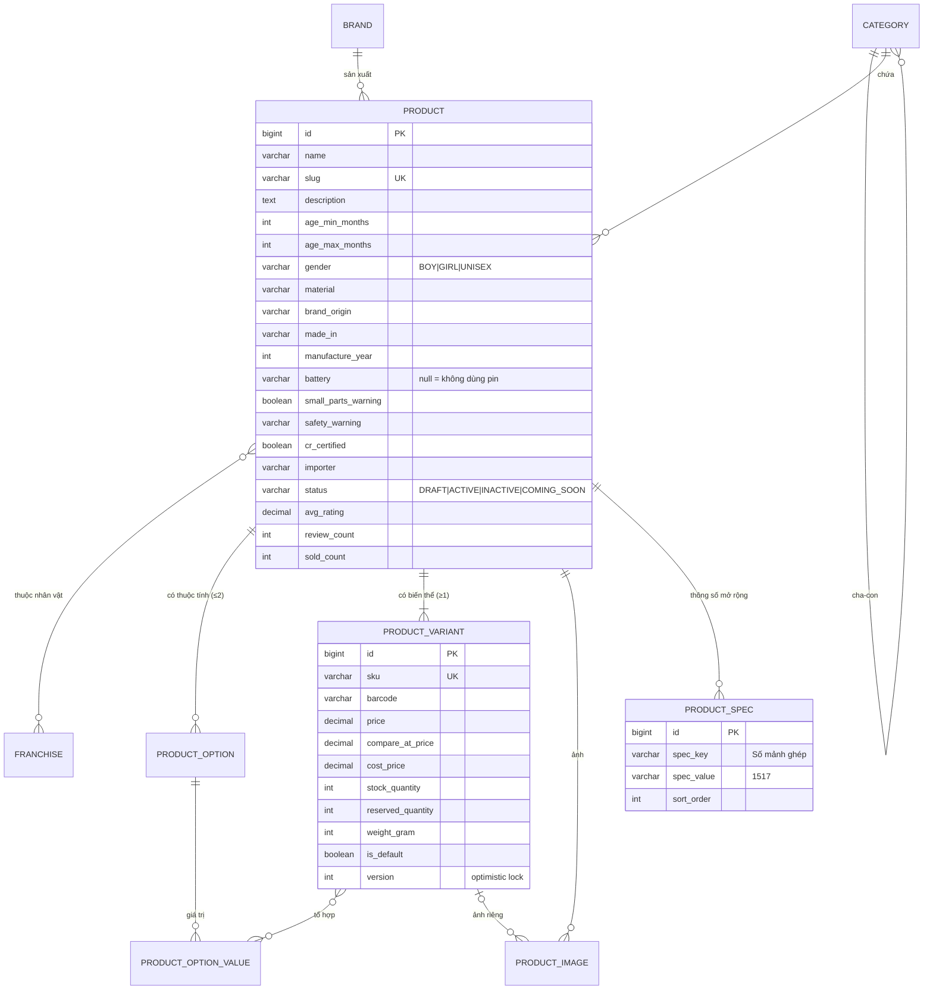
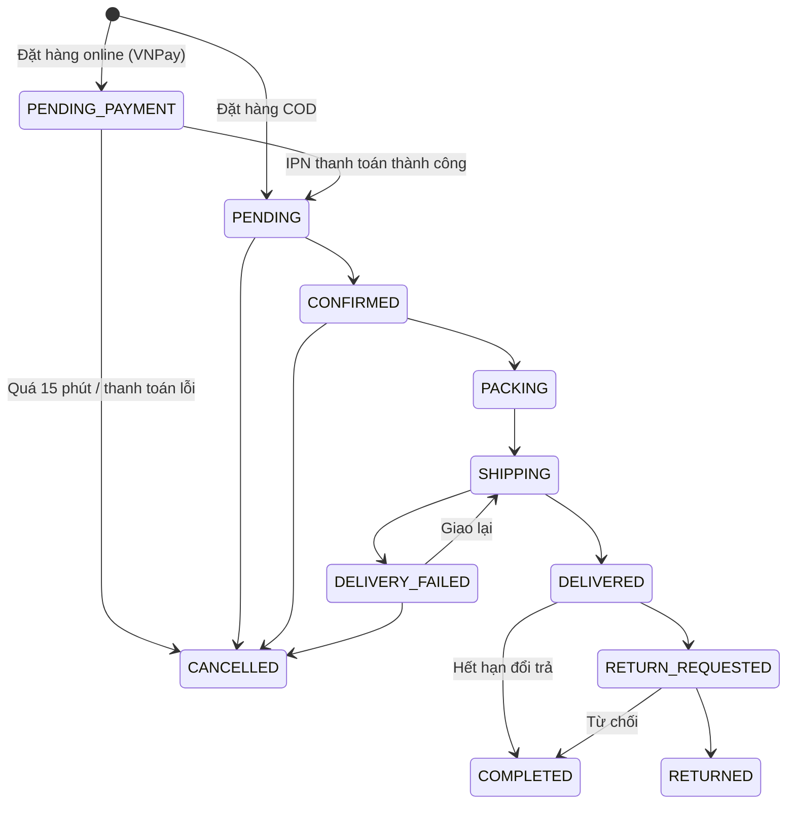

# ĐỀ XUẤT NÂNG CẤP HỆ THỐNG TOYLAND (v2)

> Trạng thái: **BẢN ĐỀ XUẤT – CHỜ CHỐT**. Chưa sửa code.
> Cách chốt: trả lời theo **mã hạng mục** (ví dụ `A1, A2, C3, F1`) hoặc chọn **một gói** ở mục 13.

Ký hiệu:
- **Mức ưu tiên:** **P0** = nên có, đồ án sẽ "ra dáng" hệ thống thật · **P1** = nâng điểm rõ rệt · **P2** = làm nếu còn thời gian
- **Độ khó:** S = nhỏ (≤ 0,5 ngày) · M = vừa (1–2 ngày) · L = lớn (3+ ngày)
- **Phạm vi:** DB / BE (Spring Boot) / FE (Angular)

---

## 0. Hệ thống tham chiếu

| Hệ thống | Loại | Mình lấy chuẩn gì |
|----------|------|-------------------|
| **MyKingdom** (mykingdom.com.vn) | Chuỗi đồ chơi lớn nhất VN, chủ phân phối LEGO | Cây danh mục, lọc theo **độ tuổi / nhân vật / thương hiệu**, bảng thông số sản phẩm, cảnh báo an toàn, freeship từ 500k, hàng outlet |
| **Shopee / Lazada / Tiki** | Sàn TMĐT | **Phân loại hàng 2 cấp** (biến thể), voucher, flash sale, đánh giá kèm ảnh, hỏi – đáp, theo dõi đơn theo mốc thời gian |
| **Shopify** | Nền tảng bán hàng chuẩn quốc tế | Mô hình **Product → Option → Variant** (tối đa 3 thuộc tính, 2048 biến thể), mỗi biến thể có SKU / giá / tồn kho / ảnh riêng, giá so sánh (`compare_at_price`) |
| **LEGO.com** | Cửa hàng hãng | Số chi tiết, độ tuổi, chủ đề (theme), chương trình thành viên, danh sách yêu thích |
| **Amazon** | TMĐT toàn cầu | "Thường được mua cùng", "Đã xem gần đây", phân bố số sao |
| **Quy định VN** | Pháp lý | QCVN 3:2019/BKHCN (nhãn đồ chơi), Luật TMĐT 2025 (hiệu lực 01/07/2026), Luật BVDLCN (hiệu lực 01/01/2026), địa giới hành chính 2 cấp (34 tỉnh, từ 01/07/2025) |

**Nhận xét:** hệ thống hiện tại đang ở mức "CRUD sản phẩm phẳng". Cả 1 sản phẩm chỉ có 1 giá, 1 tồn kho, 1 ảnh, 1 danh mục, không có thông số kỹ thuật. Đồ án sẽ khác biệt nhất ở 3 chỗ: **(1) mô hình sản phẩm – biến thể**, **(2) luồng đơn hàng có lịch sử, khuyến mãi và thanh toán**, **(3) dữ liệu đặc thù ngành đồ chơi** (độ tuổi, an toàn, nhân vật).

---

## A. THÔNG TIN SẢN PHẨM & BIẾN THỂ (trọng tâm)

### Thực tế tham chiếu

Trang sản phẩm MyKingdom (ví dụ "Uno Teams HXT58") có:
- **Bảng thông số:** Độ tuổi · Giới tính · Thương hiệu · Xuất xứ thương hiệu · Nơi sản xuất · Năm sản xuất · Chất liệu · Pin · Nhà sản xuất · Đơn vị nhập khẩu
- 8 ảnh có zoom, giá gốc gạch ngang + % giảm, "Còn 319 sản phẩm"
- **Cảnh báo:** "Có chi tiết nhỏ. Không thích hợp cho trẻ dưới 3 tuổi"

Theo QCVN 3:2019/BKHCN, nhãn đồ chơi phải có: tên sản phẩm, nhà sản xuất, nước sản xuất, độ tuổi khuyến nghị, cảnh báo an toàn tiếng Việt, dấu hợp quy **CR**.

### Hạng mục

| Mã | Hạng mục | Mô tả | Tham chiếu | Ưu tiên | Độ khó |
|----|----------|-------|------------|---------|--------|
| **A1** | **Biến thể sản phẩm (Variant)** | Tách `product` (thông tin chung) và `product_variant` (SKU, giá, giá gốc, tồn kho, ảnh, trọng lượng). Tối đa **2 thuộc tính** như Shopee, ví dụ Màu sắc × Kích thước. Sản phẩm không có biến thể thì dùng 1 variant mặc định (cách Shopify làm). | Shopee, Shopify | **P0** | L |
| **A2** | **Bảng thông số kỹ thuật** | Cột cố định: độ tuổi (từ – đến, tính theo tháng), giới tính (Bé trai / Bé gái / Unisex), chất liệu, xuất xứ thương hiệu, nơi sản xuất, năm SX, cần pin (loại pin), kích thước hộp, trọng lượng. Cộng thêm **thông số mở rộng key–value** theo danh mục: số mảnh ghép (LEGO), số người chơi (board game), tỉ lệ (xe mô hình), tần số điều khiển (RC). | MyKingdom, LEGO.com | **P0** | M |
| **A3** | **Nhãn an toàn theo QCVN 3** | Cờ "có chi tiết nhỏ", cảnh báo tùy chỉnh, dấu CR, đơn vị nhập khẩu. Hiển thị khối cảnh báo màu vàng trên trang chi tiết. | QCVN 3:2019, MyKingdom | **P0** | S |
| **A4** | **Bộ sưu tập ảnh + video** | Nhiều ảnh, sắp xếp thứ tự, ảnh gắn với biến thể (chọn màu đỏ thì đổi sang ảnh đỏ), zoom, link video YouTube. | Shopee, MyKingdom | **P0** | M |
| **A5** | **Upload ảnh thật lên server** | Admin tải ảnh (multipart) thay vì dán URL. Lưu `uploads/`, trả URL tĩnh, có resize/thumbnail. | Mọi hệ thống | **P0** | M |
| **A6** | **Nhân vật / Chủ đề (Franchise)** | Bảng `franchise` (Marvel, Paw Patrol, Barbie, Harry Potter…), mỗi sản phẩm gắn 0..n. Có trang "Đồ chơi theo nhân vật". | MyKingdom ("Đồ chơi theo phim") | P1 | S |
| **A7** | **Danh mục đa cấp** | Danh mục cha – con, ví dụ Lắp ráp → LEGO City / LEGO Technic. Có breadcrumb, 1 sản phẩm thuộc 1 danh mục chính. | MyKingdom, Tiki | P1 | M |
| **A8** | **Giá gốc – giá bán – % giảm** | `compare_at_price` trên từng biến thể, badge "-40%", "Độc quyền online", "Mới", "Bán chạy", "Outlet". | MyKingdom, Shopify | **P0** | S |
| **A9** | **Trạng thái sản phẩm** | NHÁP → ĐANG BÁN → NGỪNG BÁN, thêm "Sắp về" (cho đặt báo khi có hàng). | Shopify | P1 | S |
| **A10** | **Slug URL tiếng Việt không dấu** | `/san-pham/lego-city-trung-tam-thanh-pho-60380` thay cho `/products/1`, kèm meta title / description (SEO). | Tất cả | P1 | S |
| **A11** | **Sản phẩm liên quan / combo** | Cùng danh mục/nhân vật; "Thường được mua cùng" (tính từ order_items); combo quà tặng. | Amazon, Shopee | P2 | M |
| **A12** | **Nhập sản phẩm hàng loạt từ Excel/CSV** | Admin upload file để tạo nhiều sản phẩm và biến thể một lần. | Shopee Seller Center | P2 | M |

### Mô hình dữ liệu đề xuất cho A1–A6

> **Lưu ý thực tế ngành đồ chơi:** phần lớn đồ chơi (bộ LEGO, board game) **không có biến thể**, mỗi mã là một sản phẩm riêng. Biến thể chủ yếu gặp ở thú bông (kích cỡ 30/50/80 cm), búp bê / xe (màu sắc), đồ thời trang. Vì vậy mô hình "luôn có ≥1 variant mặc định" giúp cả 2 trường hợp dùng chung code. Mình sẽ tạo dữ liệu mẫu có cả hai loại.

**Ảnh hưởng dây chuyền:** giỏ hàng, chi tiết đơn, tồn kho sẽ chuyển từ `product_id` sang `variant_id`. Đây là thay đổi lớn nhất, nên làm **đầu tiên**.

---

## B. TÌM KIẾM & KHÁM PHÁ

| Mã | Hạng mục | Mô tả | Tham chiếu | Ưu tiên | Độ khó |
|----|----------|-------|------------|---------|--------|
| **B1** | **Bộ lọc đa chiều (faceted)** | Lọc theo độ tuổi (0–12 tháng, 1–3, 3–6, 6–12, 12+), giới tính, nhiều thương hiệu, nhân vật, khoảng giá, còn hàng, đang giảm giá. Hiện **số lượng** cạnh mỗi lựa chọn. Filter được lưu trên URL. | MyKingdom, Tiki | **P0** | M |
| **B2** | **Sắp xếp nâng cao** | Bán chạy, mới nhất, giá tăng/giảm, đánh giá cao, giảm giá nhiều. | Shopee | **P0** | S |
| **B3** | **Gợi ý tìm kiếm (autocomplete)** | Gõ "leg…" → gợi ý sản phẩm, danh mục, thương hiệu. Tìm không dấu ("bup be" ra "búp bê"). | Shopee, Tiki | P1 | M |
| **B4** | **Trang "Mua theo độ tuổi" / "theo nhân vật" / "theo thương hiệu"** | Các khối khám phá ở trang chủ và trang riêng. | MyKingdom | P1 | S |
| **B5** | **Sản phẩm đã xem gần đây** | Lưu localStorage, hiện ở trang chủ / chi tiết. | Amazon | P1 | S |
| **B6** | **Danh sách yêu thích (Wishlist)** | Nút ♥ trên card, trang "Yêu thích" (lưu DB khi đã đăng nhập). | LEGO.com, Shopee | P1 | S |
| **B7** | **So sánh sản phẩm** | Chọn 2–4 món, so bảng thông số. | Thế Giới Di Động | P2 | M |
| **B8** | **Gợi ý quà tặng theo độ tuổi + ngân sách** | Form nhỏ: "Bé 5 tuổi, dưới 500k" → danh sách. | Đặc thù đồ chơi | P2 | S |

---

## C. GIỎ HÀNG & THANH TOÁN (CHECKOUT)

| Mã | Hạng mục | Mô tả | Tham chiếu | Ưu tiên | Độ khó |
|----|----------|-------|------------|---------|--------|
| **C1** | **Chọn biến thể khi thêm giỏ** | Nút chọn Màu / Size, giá – tồn kho – ảnh đổi theo lựa chọn; biến thể hết hàng bị làm mờ. | Shopee | **P0** (đi cùng A1) | M |
| **C2** | **Giỏ hàng cho khách chưa đăng nhập** | Lưu localStorage, **gộp vào giỏ server** khi đăng nhập. | Tiki, Shopee | P1 | M |
| **C3** | **Mini-cart / drawer** | Thêm giỏ → mở ngăn bên phải xem nhanh, không rời trang. | MyKingdom, Shopify | P1 | S |
| **C4** | **Sổ địa chỉ theo địa giới 2 cấp** | Bảng `address` (nhiều địa chỉ, 1 mặc định). Dropdown **Tỉnh/Thành (34) → Phường/Xã** theo đơn vị hành chính mới từ 01/07/2025 (đã bỏ cấp huyện). Seed dữ liệu vào DB. | Shopee, quy định 2025 | **P0** | M |
| **C5** | **Phí vận chuyển** | Cách 1 (khuyến nghị): quy tắc nội bộ, freeship đơn ≥ 500.000đ như MyKingdom, còn lại tính theo vùng/trọng lượng. Cách 2: gọi **API GHN sandbox** tính phí thật. | MyKingdom, GHN API | **P0** / P2 | S / L |
| **C6** | **Mã giảm giá (Voucher)** | % hoặc số tiền, giá trị đơn tối thiểu, giảm tối đa, hạn dùng, số lượt, 1 lần/khách, áp cho danh mục. Có ô nhập mã và danh sách voucher có thể dùng. | Shopee, Tiki | **P0** | M |
| **C7** | **Thanh toán VNPay (sandbox)** | Chuyển sang cổng VNPay, nhận **IPN/return URL**, kiểm tra chữ ký HMAC-SHA512, cập nhật trạng thái thanh toán. Rất hợp chủ đề "hướng dịch vụ" (tích hợp service bên thứ 3). | VNPay sandbox | P1 | L |
| **C8** | **Gói quà + lời chúc** | Tùy chọn gói quà (+phí) và thiệp lời nhắn, đặc thù hàng đồ chơi làm quà. | MyKingdom, Amazon | P2 | S |
| **C9** | **Giữ hàng khi đặt & chống bán vượt tồn** | Trừ tồn trong transaction + **optimistic lock (`@Version`)** trên variant; đơn chờ thanh toán online quá 15 phút tự hủy và trả hàng. | Mọi sàn | **P0** | M |
| **C10** | **Mua ngay (Buy now)** | Đặt nhanh 1 sản phẩm, bỏ qua giỏ. | Shopee, MyKingdom | P2 | S |

---

## D. ĐƠN HÀNG & HẬU MÃI

| Mã | Hạng mục | Mô tả | Tham chiếu | Ưu tiên | Độ khó |
|----|----------|-------|------------|---------|--------|
| **D1** | **Lịch sử trạng thái đơn (timeline)** | Bảng `order_status_history` (trạng thái, thời gian, người đổi, ghi chú). Frontend hiển thị dạng mốc như Shopee: Đặt hàng → Xác nhận → Giao cho vận chuyển → Đã giao. | Shopee | **P0** | S |
| **D2** | **Tách trạng thái thanh toán** | `payment_status`: UNPAID / PAID / REFUNDED, độc lập với trạng thái giao hàng. | Shopify | **P0** | S |
| **D3** | **Lý do hủy đơn** | Khách chọn lý do khi hủy; admin xem thống kê lý do. | Shopee | P1 | S |
| **D4** | **Yêu cầu đổi trả / hoàn tiền** | Trong X ngày sau khi giao: chọn sản phẩm, lý do, ảnh; admin duyệt/từ chối; hàng outlet thì không đổi trả (như MyKingdom). | Shopee, MyKingdom | P1 | L |
| **D5** | **Tra cứu đơn không cần đăng nhập** | Nhập mã đơn + SĐT để xem trạng thái. | MyKingdom ("Kiểm tra đơn hàng") | P1 | S |
| **D6** | **Email thông báo** | Gửi email khi đặt hàng, đổi trạng thái, quên mật khẩu (Spring Mail + template Thymeleaf; test bằng Mailtrap / Gmail App Password). | Tất cả | P1 | M |
| **D7** | **Xuất hóa đơn / phiếu giao hàng PDF** | Admin in phiếu giao hàng; khách tải hóa đơn. | Shopee Seller | P2 | M |
| **D8** | **Mua lại (Re-order)** | Một nút đưa lại các món của đơn cũ vào giỏ. | Shopee, Tiki | P2 | S |

Luồng đề xuất sau nâng cấp:

---

## E. KHUYẾN MÃI & MARKETING

| Mã | Hạng mục | Mô tả | Tham chiếu | Ưu tiên | Độ khó |
|----|----------|-------|------------|---------|--------|
| **E1** | **Chương trình giảm giá theo thời gian** | Giảm % cho danh mục / thương hiệu / sản phẩm từ ngày – đến ngày. Ví dụ "Trung thu -40% 01/09–30/09" như MyKingdom. | MyKingdom | P1 | M |
| **E2** | **Flash sale** | Khung giờ, số lượng giới hạn, đồng hồ đếm ngược, thanh "đã bán x%". | Shopee | P2 | L |
| **E3** | **Banner / slider do admin quản lý** | CRUD banner (ảnh, link, thứ tự, thời gian hiển thị) cho trang chủ. | MyKingdom | P1 | S |
| **E4** | **Điểm thưởng / hạng thành viên** | Tích điểm theo đơn hoàn tất, dùng điểm trừ tiền; hạng Bạc/Vàng/Kim cương. | MyKingdom (Thành viên), LEGO Insiders, Shopee Xu | P2 | L |
| **E5** | **Blog / cẩm nang chọn đồ chơi** | Bài viết đơn giản gắn sản phẩm. | MyKingdom Blog | P2 | M |

---

## F. ĐÁNH GIÁ & TƯƠNG TÁC

| Mã | Hạng mục | Mô tả | Tham chiếu | Ưu tiên | Độ khó |
|----|----------|-------|------------|---------|--------|
| **F1** | **Đánh giá sản phẩm** | 1–5 sao + nội dung + ảnh; **chỉ khách đã mua (đơn COMPLETED) mới đánh giá**, gắn nhãn "Đã mua hàng"; có biểu đồ phân bố sao; admin ẩn/duyệt và phản hồi. | Shopee, Tiki, Amazon | **P0** | M |
| **F2** | **Hỏi – đáp sản phẩm** | Khách hỏi, admin trả lời, hiện công khai. | Tiki, Amazon | P2 | M |
| **F3** | **Báo khi có hàng** | Sản phẩm hết hàng → nút "Báo tôi khi có hàng" (email). | Tiki, LEGO.com | P2 | S |

---

## G. TÀI KHOẢN & BẢO MẬT

| Mã | Hạng mục | Mô tả | Tham chiếu | Ưu tiên | Độ khó |
|----|----------|-------|------------|---------|--------|
| **G1** | **Refresh token + đăng xuất thật** | Access token 15 phút + refresh token 7 ngày (lưu DB, thu hồi được khi đăng xuất / đổi mật khẩu). | Chuẩn OAuth2 | P1 | M |
| **G2** | **Quên mật khẩu qua email** | Token đặt lại mật khẩu có hạn 15 phút. | Tất cả | P1 | M (cần D6) |
| **G3** | **Xác thực email khi đăng ký** | Tài khoản kích hoạt sau khi bấm link. | Tiki | P2 | S (cần D6) |
| **G4** | **Vai trò STAFF (nhân viên)** | STAFF xử lý đơn và tồn kho nhưng không quản lý tài khoản / cấu hình. Phân quyền 3 cấp. | Shopify Staff | P1 | S |
| **G5** | **Giới hạn đăng nhập sai** | Khóa 15 phút sau 5 lần sai (chống brute-force). | OWASP | P1 | S |
| **G6** | **Đăng nhập Google (OAuth2)** | Thêm nút "Đăng nhập với Google". | Shopee, Tiki | P2 | L |
| **G7** | **Hồ sơ con / sinh nhật bé** | Lưu tên + ngày sinh của bé để gợi ý đồ chơi đúng tuổi, gửi voucher sinh nhật. | Đặc thù ngành mẹ & bé | P2 | M |

---

## H. QUẢN TRỊ (ADMIN)

| Mã | Hạng mục | Mô tả | Tham chiếu | Ưu tiên | Độ khó |
|----|----------|-------|------------|---------|--------|
| **H1** | **Dashboard có biểu đồ** | Doanh thu theo ngày/tháng (line chart), top 10 sản phẩm bán chạy, doanh thu theo danh mục (bar), tỉ lệ hủy; bộ lọc khoảng ngày. Dùng `ng2-charts` / Chart.js. | Shopee Seller, Shopify Analytics | **P0** | M |
| **H2** | **Quản lý kho** | Phiếu **nhập kho** (nhà cung cấp, số lượng, giá nhập), điều chỉnh tồn (hỏng, kiểm kê); bảng **`stock_movement`** ghi mọi biến động (nhập / bán / hủy / trả / điều chỉnh) để truy vết. | Shopify Inventory, KiotViet | P1 | L |
| **H3** | **Form sản phẩm mới** | Form nhiều tab (Thông tin / Thông số / Biến thể / Ảnh / SEO). Sinh tổ hợp biến thể tự động từ các thuộc tính (Màu × Size) như Shopee Seller Center, nhập giá/tồn hàng loạt. | Shopee Seller Center | **P0** (đi cùng A1) | L |
| **H4** | **Xử lý đơn hàng** | Lọc theo trạng thái / ngày / thanh toán, đổi trạng thái hàng loạt, in phiếu, ghi chú nội bộ, xem timeline. | Shopee Seller | P1 | M |
| **H5** | **Nhật ký thao tác (Audit log)** | Ghi ai sửa gì, lúc nào (giá, tồn, trạng thái đơn). `@CreatedBy / @LastModifiedBy` của Spring Data JPA Auditing. | Shopify | P2 | M |
| **H6** | **Xuất báo cáo Excel** | Xuất danh sách đơn / doanh thu / tồn kho ra .xlsx (Apache POI). | KiotViet | P2 | M |
| **H7** | **Quản lý đánh giá, voucher, banner** | Các màn CRUD tương ứng F1, C6, E3. | — | theo F1/C6/E3 | S |

---

## I. UX / UI

| Mã | Hạng mục | Mô tả | Tham chiếu | Ưu tiên | Độ khó |
|----|----------|-------|------------|---------|--------|
| **I1** | **Ảnh sản phẩm thật + dữ liệu mẫu thật** | ~40–60 sản phẩm có ảnh thật, mô tả, thông số (thay placeholder chữ). | — | **P0** | M |
| **I2** | **Trang chi tiết kiểu sàn** | Gallery + thumbnail + zoom; khối giá (giá bán, gạch giá gốc, badge %); chọn biến thể; số lượng; nút **Thêm giỏ + Mua ngay**; khối chính sách (freeship ≥500k, đổi trả 7 ngày, chính hãng); tab **Mô tả / Thông số / Đánh giá**; cảnh báo an toàn; sản phẩm liên quan; **thanh mua hàng dính** khi cuộn trên mobile. | MyKingdom, Shopee | **P0** | M |
| **I3** | **Card sản phẩm giàu thông tin** | Badge (-%, Mới, Bán chạy, Độc quyền online), sao + "Đã bán 1,2k", độ tuổi, nút ♥, hover đổi sang ảnh thứ 2. | Shopee, MyKingdom | **P0** | S |
| **I4** | **Trang chủ theo khối** | Slider banner, danh mục dạng icon, "Mua theo độ tuổi", flash sale / khuyến mãi, bán chạy, theo nhân vật, thương hiệu, blog. | MyKingdom | P1 | M |
| **I5** | **Mega menu danh mục** | Rê chuột vào "Sản phẩm" → menu nhiều cột theo danh mục cha–con, thương hiệu, nhân vật. | MyKingdom | P1 | M |
| **I6** | **Responsive mobile đầy đủ** | Bottom navigation (Trang chủ / Danh mục / Giỏ / Tài khoản), bộ lọc dạng bottom-sheet, bảng admin cuộn ngang. | Shopee app-like | **P0** | M |
| **I7** | **Trạng thái tải & rỗng** | Skeleton loading thay spinner, empty-state có minh họa, trang 404, xử lý lỗi mạng thân thiện. | Material Design | P1 | S |
| **I8** | **Checkout nhiều bước** | Stepper Địa chỉ → Vận chuyển → Thanh toán → Xác nhận; trang **"Đặt hàng thành công"** riêng. | Shopify Checkout | P1 | M |
| **I9** | **Bộ nhận diện riêng** | Theme Material 3 tùy biến màu thương hiệu ToyLand (thay azure mặc định), font Nunito/Quicksand thân thiện trẻ em và hỗ trợ tiếng Việt, logo, favicon. | — | P1 | S |
| **I10** | **Khả năng truy cập (a11y)** | Tương phản đạt WCAG AA, `alt` cho ảnh, điều hướng bằng bàn phím, focus rõ. | WCAG 2.1 | P2 | S |
| **I11** | **Chế độ tối (dark mode)** | Nút chuyển sáng / tối cho admin. | Material 3 | P2 | S |

---

## J. KỸ THUẬT (điểm cộng khi chấm "hướng dịch vụ")

| Mã | Hạng mục | Mô tả | Ưu tiên | Độ khó |
|----|----------|-------|---------|--------|
| **J1** | **DTO + Mapper cho mọi response** | Không trả Entity trực tiếp (tránh lộ dữ liệu, lỗi lazy-loading); dùng record DTO + MapStruct. | **P0** | M |
| **J2** | **Quản lý phiên bản CSDL bằng Flyway** | `V1__init.sql`, `V2__variants.sql`… chạy tự động khi khởi động, không cần chạy script tay. | **P0** | S |
| **J3** | **Chuẩn hóa API** | Tiền tố `/api/v1`, tài nguyên con (`/products/{id}/variants`, `/products/{id}/reviews`), response phân trang thống nhất, mã lỗi nghiệp vụ (`ORDER_OUT_OF_STOCK`…). | **P0** | S |
| **J4** | **Soft delete + Auditing** | `deleted_at`, `created_at / updated_at / created_by` tự động cho mọi bảng. | P1 | S |
| **J5** | **Kiểm thử tự động** | Unit test service (Mockito), integration test controller (MockMvc + H2/Testcontainers); Postman collection kèm test script cho mọi API mới. | P1 | M |
| **J6** | **Docker Compose** | Một lệnh `docker compose up` chạy MySQL + backend + frontend (nginx), tiện demo trên máy thầy. | P2 | M |
| **J7** | **Cache** | Cache danh mục / thương hiệu / sản phẩm nổi bật bằng Spring Cache (Caffeine). | P2 | S |
| **J8** | **Tách module theo miền nghiệp vụ** | Tổ chức lại package theo **domain** (`catalog`, `order`, `customer`, `payment`, `promotion`) thay vì theo tầng. Thể hiện tư duy SOA / microservice-ready, vẫn giữ 1 ứng dụng. | P1 | M |
| **J9** | **Lazy-load route Angular + interceptor loading** | Tách bundle admin / shop, thanh tiến trình toàn cục khi gọi API. | P1 | S |

---

## K. TUÂN THỦ PHÁP LÝ VN (nên có trong website TMĐT thật)

| Mã | Hạng mục | Căn cứ | Ưu tiên | Độ khó |
|----|----------|--------|---------|--------|
| **K1** | Trang **Chính sách đổi trả**, **Vận chuyển**, **Bảo mật**, **Điều khoản**, **Thông tin doanh nghiệp** ở footer | Luật TMĐT 2025 (hiệu lực 01/07/2026) | P1 | S |
| **K2** | **Ô đồng ý xử lý dữ liệu cá nhân** khi đăng ký / đặt hàng; lưu thời điểm đồng ý; cho phép xóa tài khoản | Luật Bảo vệ dữ liệu cá nhân (hiệu lực 01/01/2026) | P1 | S |
| **K3** | Hiển thị đầy đủ **nhãn đồ chơi** (tuổi, cảnh báo, xuất xứ, CR) | QCVN 3:2019/BKHCN | trùng A3 | — |
| **K4** | Giá đã gồm VAT, hiển thị rõ phí ship trước khi đặt | Bảo vệ người tiêu dùng | **P0** | S |

---

## 12. Ước lượng khối lượng

| Nhóm | Số hạng mục P0 | Ghi chú |
|------|----------------|---------|
| A – Sản phẩm & biến thể | 6 | Nặng nhất, ảnh hưởng mọi thứ |
| B – Tìm kiếm | 2 | |
| C – Checkout | 4 | |
| D – Đơn hàng | 2 | |
| F – Đánh giá | 1 | |
| H – Admin | 2 | |
| I – UX/UI | 4 | |
| J – Kỹ thuật | 3 | |
| K – Pháp lý | 1 | |

Số bảng CSDL dự kiến: **7 hiện tại → ~20 bảng** (gói Nâng cao), gồm product_variant, product_option(+value), variant_option_value, product_image, product_spec, franchise, product_franchise, address, province, ward, voucher, voucher_usage, order_status_history, review, review_image, wishlist, (stock_movement, banner, refresh_token…).

---

## 13. Ba gói gợi ý để chốt

| Gói | Gồm | Phù hợp |
|-----|-----|---------|
| **🅐 Cốt lõi** | Tất cả **P0**: A1–A5, A8 · B1–B2 · C1, C4, C5 (quy tắc nội bộ), C6, C9 · D1–D2 · F1 · H1, H3 · I1–I3, I6 · J1–J3 · K4 | Nhóm 2 người, muốn hệ thống chắc chắn, demo mượt. **Mình khuyến nghị gói này làm nền.** |
| **🅑 Nâng cao** | 🅐 + A6, A7, A9, A10 · B3–B6 · C2, C3, **C7 (VNPay)** · D3–D6 · E1, E3 · G1, G2, G4, G5 · H2, H4 · I4, I5, I7–I9 · J4, J5, J8, J9 · K1, K2 | Nhóm 3 người, muốn điểm cao, có tích hợp dịch vụ ngoài đúng chất SOA |
| **🅒 Đầy đủ** | 🅑 + mọi P2 | Nhiều thời gian, làm như sản phẩm thật |

**Thứ tự triển khai (dù chọn gói nào):**
1. J2 Flyway + J1 DTO + J3 chuẩn hóa API
2. A1–A5 mô hình sản phẩm – biến thể + upload ảnh
3. H3 form sản phẩm admin + I1 dữ liệu mẫu thật
4. B1–B2 lọc / sắp xếp → I2–I3 trang chi tiết & card
5. C (giỏ, địa chỉ, ship, voucher) → D (đơn, timeline) → C7 thanh toán
6. F đánh giá → H1 dashboard biểu đồ → phần còn lại

---

## 14. Câu hỏi cần bạn chốt

1. **Gói nào** (🅐 / 🅑 / 🅒), hoặc danh sách mã tự chọn?
2. **Biến thể:** tối đa **2 thuộc tính** như Shopee, hay 3 như Shopify?
3. **Thanh toán VNPay sandbox (C7):** có làm không? Bạn cần tự đăng ký tài khoản sandbox miễn phí (lấy `TmnCode` + `HashSecret`).
4. **Email (D6, G2):** dùng Gmail App Password của nhóm hay Mailtrap (hộp thư test, không gửi thật)?
5. **Phí ship:** quy tắc nội bộ (freeship ≥ 500k) hay gọi API GHN thật?
6. **Dữ liệu cũ:** được phép **tạo lại CSDL từ đầu** (script mới + Flyway), hay phải giữ dữ liệu đang có?
7. **Ảnh sản phẩm thật (I1):** bạn tự chuẩn bị ảnh, hay để mình dùng ảnh minh họa không bản quyền?

---

### Nguồn tham chiếu

- MyKingdom – trang chủ và trang sản phẩm Uno Teams HXT58: https://www.mykingdom.com.vn/ · https://www.mykingdom.com.vn/collections/tro-choi-giai-tri/products/tro-choi-tri-tue-uno-teams-mattel-games-hxt58
- Shopee – phân loại hàng tối đa 2 nhóm, 50 lựa chọn/nhóm: https://ginee.com/vn/insights/cach-phan-loai-hang-tren-shopee/ · https://banhang.shopee.vn/edu/article/3528
- Shopify – 2048 biến thể / 3 thuộc tính: https://shopify.dev/changelog/the-product-variant-limit-is-now-2048-for-all-merchants · https://getpinflow.com/blog/shopify-variant-limit
- QCVN 3:2019/BKHCN An toàn đồ chơi trẻ em: https://thuvienphapluat.vn/TCVN/Cong-nghiep/QCVN-3-2019-BKHCN-An-toan-do-choi-tre-em-918428.aspx · https://issq.org.vn/cach-nhan-biet-do-choi-an-toan-cho-tre-duoi-3-tuoi-voi-qcvn-3/
- Luật Thương mại điện tử 2025 (hiệu lực 01/07/2026): https://luatvietan.vn/luat-thuong-mai-dien-tu.html · https://moit.gov.vn/tin-tuc/luat-thuong-mai-dien-tu-chinh-thuc-duoc-quoc-hoi-thong-qua.html
- Luật Bảo vệ dữ liệu cá nhân (hiệu lực 01/01/2026): https://baochinhphu.vn/luat-bao-ve-du-lieu-ca-nhan-chinh-thuc-co-hieu-luc-tu-ngay-mai-1-1-2026-102251231155609721.htm
- Địa giới hành chính 2 cấp, 34 tỉnh: https://xaydungchinhsach.chinhphu.vn/danh-sach-3321-don-vi-hanh-chinh-cap-xa-tai-34-tinh-thanh-sau-sap-xep-sap-nhap-119250710102358656.htm
- VNPay sandbox: https://sandbox.vnpayment.vn/apis/docs/gioi-thieu/
- GHN API tính phí: https://api.ghn.vn/home/docs/detail?id=95
