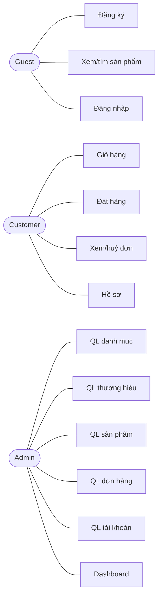
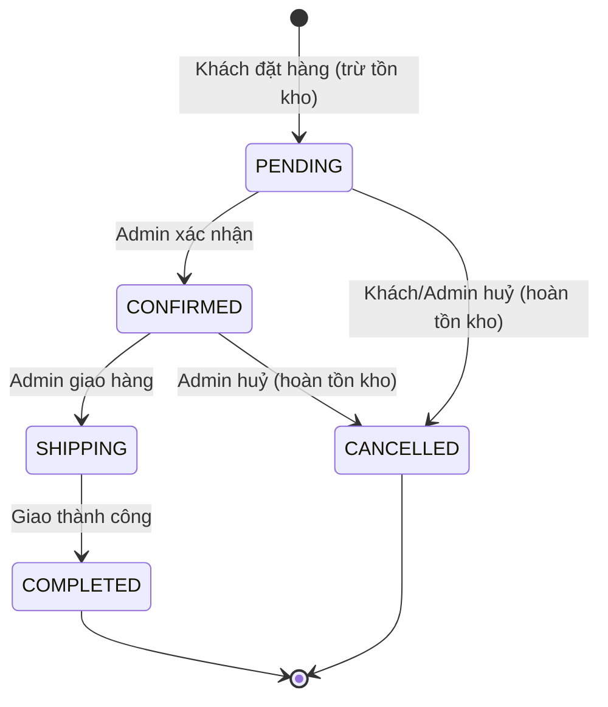
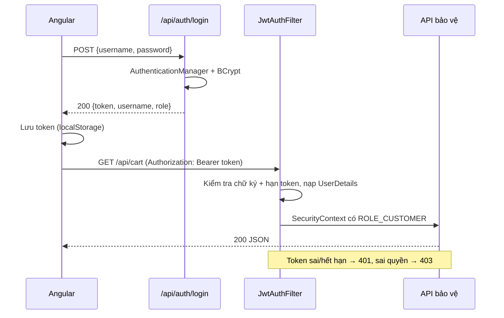
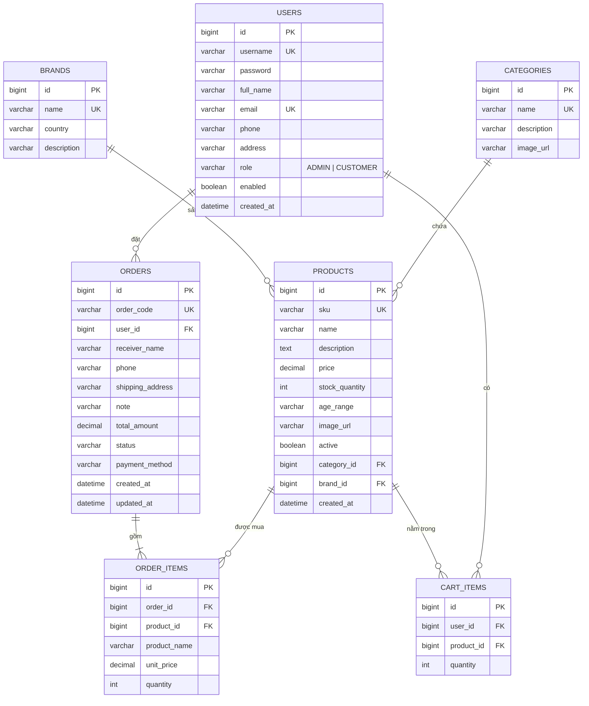

# KẾ HOẠCH ĐỒ ÁN – HỆ THỐNG QUẢN LÝ CỬA HÀNG ĐỒ CHƠI TRỰC TUYẾN (ToyLand)

> Học phần: **Phát triển phần mềm hướng dịch vụ**
> Kiến trúc: **Client/Server hướng dịch vụ** – Spring Boot (RESTful Web Service) + Angular (Client, Material Design) + MySQL
> Package gốc backend: `com.toyland` · Tiền tố API: `/api`

---

## 1. Giới thiệu & lý do chọn đề tài

Cửa hàng đồ chơi có danh mục hàng hoá đa dạng (lắp ráp, búp bê, xe mô hình, đồ chơi giáo dục…), nhiều thương hiệu, và mỗi sản phẩm có độ tuổi phù hợp riêng. Việc quản lý thủ công (Excel, sổ sách) gây khó khăn khi theo dõi tồn kho, đơn hàng và khách hàng. Hệ thống **ToyLand** cung cấp:

- **Kênh bán hàng trực tuyến** cho khách: xem – tìm kiếm – lọc đồ chơi, thêm giỏ hàng, đặt hàng, theo dõi đơn.
- **Trang quản trị** cho cửa hàng: quản lý danh mục, thương hiệu, sản phẩm, tồn kho, đơn hàng, tài khoản, thống kê doanh thu.
- Toàn bộ nghiệp vụ được cung cấp dưới dạng **RESTful Web Service** (JSON), client Angular chỉ giao tiếp với server qua HTTP → đúng tinh thần SOA của học phần.

## 2. Mục tiêu

| # | Mục tiêu | Tiêu chí hoàn thành | Liên hệ Lab |
|---|----------|---------------------|-------------|
| M1 | Thiết kế CSDL quan hệ MySQL cho cửa hàng đồ chơi | 7 bảng, có khoá chính/ngoại, ràng buộc toàn vẹn, dữ liệu mẫu | Lab 5, Lab 10 |
| M2 | Xây dựng RESTful API bằng Spring Boot theo mô hình Entity – Repository – Service – Controller | CRUD đầy đủ cho danh mục, thương hiệu, sản phẩm, giỏ hàng, đơn hàng, người dùng | Lab 5, 7-8, 10 |
| M3 | Xử lý ngoại lệ & trả mã HTTP đúng chuẩn REST | 200/201/204/400/401/403/404/409 trả JSON thống nhất | Lab 7-8, Lab 10 (`ResourceNotFoundException`) |
| M4 | Bảo mật bằng Spring Security 6 + JWT, mật khẩu BCrypt, phân quyền ADMIN/CUSTOMER | Đăng ký/đăng nhập nhận token; API admin chặn 403 với customer | Lab 9 (mở rộng từ HTTP Basic sang JWT) |
| M5 | Tài liệu hoá API bằng Swagger UI (springdoc) | Truy cập `http://localhost:8080/swagger-ui/index.html` | Lab 9 |
| M6 | Client Angular (standalone component) + Angular Material | Storefront + trang quản trị gọi API thật qua `HttpClient` | Lab 11 (+ Lab 5 phần client `fetch`) |
| M7 | Kiểm thử API bằng Postman | Collection đầy đủ, có biến `{{token}}` tự lưu sau khi login | Lab 4, Lab 7-8 |

## 3. Phạm vi chức năng

### 3.1. Tác nhân (Actor)

| Actor | Mô tả |
|-------|-------|
| **Khách vãng lai (Guest)** | Chưa đăng nhập; xem, tìm kiếm, lọc sản phẩm; đăng ký tài khoản |
| **Khách hàng (CUSTOMER)** | Đã đăng nhập; quản lý giỏ hàng, đặt hàng, xem/huỷ đơn của mình, cập nhật hồ sơ, đổi mật khẩu |
| **Quản trị viên (ADMIN)** | Quản lý danh mục, thương hiệu, sản phẩm & tồn kho, đơn hàng (duyệt/giao/hoàn tất/huỷ), tài khoản, xem thống kê |

### 3.2. Danh sách Use Case

| Mã | Use case | Actor |
|----|----------|-------|
| UC01 | Đăng ký tài khoản | Guest |
| UC02 | Đăng nhập (nhận JWT) / Đăng xuất | Guest, Customer, Admin |
| UC03 | Xem danh sách sản phẩm (phân trang, sắp xếp) | Tất cả |
| UC04 | Tìm kiếm / lọc sản phẩm theo từ khoá, danh mục, thương hiệu, khoảng giá | Tất cả |
| UC05 | Xem chi tiết sản phẩm | Tất cả |
| UC06 | Quản lý giỏ hàng (thêm, sửa số lượng, xoá, xoá hết) | Customer |
| UC07 | Đặt hàng (checkout từ giỏ hàng, trừ tồn kho) | Customer |
| UC08 | Xem lịch sử đơn hàng & chi tiết đơn | Customer |
| UC09 | Huỷ đơn hàng (khi đơn còn PENDING, hoàn tồn kho) | Customer |
| UC10 | Cập nhật hồ sơ cá nhân, đổi mật khẩu | Customer, Admin |
| UC11 | CRUD danh mục đồ chơi | Admin |
| UC12 | CRUD thương hiệu | Admin |
| UC13 | CRUD sản phẩm, cập nhật tồn kho, ẩn/hiện sản phẩm | Admin |
| UC14 | Quản lý đơn hàng: xem, lọc theo trạng thái, cập nhật trạng thái | Admin |
| UC15 | CRUD tài khoản người dùng, khoá/mở khoá | Admin |
| UC16 | Xem Dashboard thống kê (doanh thu, số đơn, sản phẩm sắp hết hàng) | Admin |



### 3.3. Luồng trạng thái đơn hàng



### 3.4. Ngoài phạm vi (hướng phát triển)

Thanh toán online (VNPay/MoMo), upload ảnh lên server/cloud, mã giảm giá, đánh giá sản phẩm, gửi email xác nhận, refresh token, triển khai Docker/cloud.

## 4. Công nghệ sử dụng

| Tầng | Công nghệ | Phiên bản | Ghi chú |
|------|-----------|-----------|---------|
| Ngôn ngữ backend | Java (JDK) | 17+ | Như Lab 7-10 (kiểm tra Window → Preferences → Installed JREs) |
| Framework backend | Spring Boot | 3.5.5 | Tạo bằng *Spring Starter Project* trong Eclipse (Lab 10) |
| Web | Spring Web (`@RestController`) | – | REST JSON |
| Truy cập dữ liệu | Spring Data JPA + Hibernate (`jakarta.persistence`) | – | `JpaRepository` như Lab 5/10 |
| CSDL | MySQL | 8.x (hoặc MariaDB của XAMPP) | Quản lý bằng MySQL Workbench / phpMyAdmin |
| Driver | `mysql-connector-j` | – | |
| Bảo mật | Spring Security 6 + JWT (`jjwt` 0.12.6) + BCrypt | – | `SecurityFilterChain` như Lab 9 |
| Validation | `spring-boot-starter-validation` | – | `@NotBlank`, `@Min`, `@Email`… |
| Tài liệu API | springdoc-openapi (Swagger UI) | 2.8.x | Lab 9 |
| Build | Maven | – | `pom.xml`, packaging `war` + `ServletInitializer` (Lab 10) |
| IDE backend | Eclipse (Spring Tools) | – | Import → *Existing Maven Projects* |
| Frontend | Angular (standalone components) | 19.x | Lab 11 – `ng new`, `ng g c`, `ng serve` port 4200 |
| UI | Angular Material | 19.x | Theme `azure-blue`, Material Icons |
| Ngôn ngữ frontend | TypeScript, HTML, SCSS | – | |
| IDE frontend | Visual Studio Code | – | Lab 11 |
| Runtime frontend | Node.js + npm | Node 18.19+/20/22 | `node -v`, `npm -v` |
| Kiểm thử API | Postman, curl, Swagger UI | – | Lab 4, Lab 5, Lab 7-8 |

## 5. Kiến trúc hệ thống

### 5.1. Sơ đồ kiến trúc tổng thể (3 tầng, client/server)

```mermaid
flowchart LR
    subgraph Client["CLIENT – Angular (localhost:4200)"]
        UI[Components<br/>Angular Material] --> SV[Services<br/>HttpClient]
        SV --> IC[AuthInterceptor<br/>gắn Bearer JWT]
        GD[Route Guards<br/>authGuard / adminGuard] --> UI
    end
    subgraph Server["SERVER – Spring Boot (localhost:8080)"]
        F[JwtAuthFilter<br/>Spring Security] --> CT[Controller<br/>@RestController]
        CT --> S[Service<br/>@Service @Transactional]
        S --> R[Repository<br/>JpaRepository]
        EX[GlobalExceptionHandler] -.-> CT
    end
    DB[(MySQL<br/>toyland_db)]
    IC -- "HTTP/JSON (REST)" --> F
    R -- JDBC/Hibernate --> DB
```

### 5.2. Phân tầng backend (theo Lab 5 & Lab 10)

| Package | Vai trò | Tương ứng Lab |
|---------|---------|---------------|
| `com.toyland.model` | Entity JPA (`@Entity`, `@Table`, `@Id`, `@GeneratedValue(IDENTITY)`) + enum | `Product.java` (Lab 5), `Employee.java` (Lab 10) |
| `com.toyland.repository` | Interface kế thừa `JpaRepository<T, Long>` | `ProductRepository`, `EmployeeRepository` |
| `com.toyland.service` | Nghiệp vụ, `@Service` + `@Transactional` | `ProductService` (Lab 5) |
| `com.toyland.controller` | `@RestController`, `@GetMapping/@PostMapping/@PutMapping/@DeleteMapping` | `ProductController`, `EmployeeController` |
| `com.toyland.exception` | `ResourceNotFoundException` (`@ResponseStatus(NOT_FOUND)`), `BadRequestException`, `GlobalExceptionHandler` | `ResouceNotFoundException` (Lab 10) |
| `com.toyland.security` | `SecurityConfig` (`SecurityFilterChain`, BCrypt), `JwtService`, `JwtAuthFilter`, `CustomUserDetailsService` | `ApplicationSecurityConfig` (Lab 9) |
| `com.toyland.dto` | Đối tượng request/response (LoginRequest, OrderRequest, PageResponse…) | – |
| `com.toyland.config` | CORS, OpenAPI (Swagger), `DataInitializer` tạo tài khoản admin mặc định | `SpringFoxConfig` (Lab 9) |

### 5.3. Cơ chế xác thực JWT



## 6. Thiết kế cơ sở dữ liệu

### 6.1. Sơ đồ ERD



### 6.2. Ràng buộc toàn vẹn chính

- `users.username`, `users.email`, `categories.name`, `brands.name`, `products.sku`, `orders.order_code`: **UNIQUE**.
- `cart_items (user_id, product_id)`: **UNIQUE** – mỗi sản phẩm chỉ 1 dòng trong giỏ của 1 người.
- `products.price >= 0`, `products.stock_quantity >= 0`, `*.quantity > 0`: **CHECK**.
- `order_items` lưu **snapshot** `product_name`, `unit_price` → đơn cũ không đổi khi sửa giá sản phẩm; `product_id` `ON DELETE SET NULL`.
- Xoá danh mục/thương hiệu đang có sản phẩm → bị chặn (API trả 409).
- Xoá sản phẩm đã từng được đặt → chuyển sang **ẩn** (`active = false`) thay vì xoá cứng.

Script tạo CSDL + dữ liệu mẫu: [`database/toyland_db.sql`](../database/toyland_db.sql).

## 7. Thiết kế API (RESTful)

Quy ước: JSON, tiếng Việt trong thông báo lỗi; lỗi trả dạng
`{ "timestamp", "status", "error", "message", "path", "details" }`.

### 7.1. Xác thực & tài khoản cá nhân

| Method | Endpoint | Quyền | Mô tả |
|--------|----------|-------|-------|
| POST | `/api/auth/register` | Public | Đăng ký (role CUSTOMER) → trả token |
| POST | `/api/auth/login` | Public | Đăng nhập → `{token, tokenType, username, fullName, role}` |
| GET | `/api/auth/me` | Đã đăng nhập | Thông tin người dùng hiện tại |
| PUT | `/api/users/me` | Đã đăng nhập | Cập nhật hồ sơ |
| PUT | `/api/users/me/password` | Đã đăng nhập | Đổi mật khẩu |

### 7.2. Danh mục & thương hiệu

| Method | Endpoint | Quyền | Mô tả |
|--------|----------|-------|-------|
| GET | `/api/categories` | Public | Danh sách danh mục |
| GET | `/api/categories/{id}` | Public | Chi tiết |
| POST | `/api/categories` | ADMIN | Thêm |
| PUT | `/api/categories/{id}` | ADMIN | Sửa |
| DELETE | `/api/categories/{id}` | ADMIN | Xoá (409 nếu còn sản phẩm) |
| GET/POST/PUT/DELETE | `/api/brands[/{id}]` | như trên | CRUD thương hiệu |

### 7.3. Sản phẩm

| Method | Endpoint | Quyền | Mô tả |
|--------|----------|-------|-------|
| GET | `/api/products?keyword=&categoryId=&brandId=&minPrice=&maxPrice=&page=0&size=12&sort=createdAt,desc` | Public | Tìm kiếm/lọc/phân trang (chỉ sản phẩm đang bán) |
| GET | `/api/products/{id}` | Public | Chi tiết |
| GET | `/api/products/admin?…` | ADMIN | Như trên nhưng gồm cả sản phẩm đã ẩn |
| POST | `/api/products` | ADMIN | Thêm (`categoryId`, `brandId` trong body) |
| PUT | `/api/products/{id}` | ADMIN | Sửa |
| DELETE | `/api/products/{id}` | ADMIN | Xoá (hoặc ẩn nếu đã có đơn) |

### 7.4. Giỏ hàng (CUSTOMER/ADMIN đã đăng nhập)

| Method | Endpoint | Mô tả |
|--------|----------|-------|
| GET | `/api/cart` | Xem giỏ `{items, totalQuantity, totalAmount}` |
| POST | `/api/cart` | Thêm `{productId, quantity}` (cộng dồn nếu đã có) |
| PUT | `/api/cart/{itemId}` | Cập nhật `{quantity}` |
| DELETE | `/api/cart/{itemId}` | Xoá 1 dòng |
| DELETE | `/api/cart` | Xoá toàn bộ giỏ |

### 7.5. Đơn hàng

| Method | Endpoint | Quyền | Mô tả |
|--------|----------|-------|-------|
| POST | `/api/orders` | Đã đăng nhập | Checkout từ giỏ `{receiverName, phone, shippingAddress, note, paymentMethod}` → 201 |
| GET | `/api/orders/my` | Đã đăng nhập | Đơn của tôi |
| GET | `/api/orders/{id}` | Chủ đơn / ADMIN | Chi tiết đơn |
| PUT | `/api/orders/{id}/cancel` | Chủ đơn | Huỷ đơn PENDING |
| GET | `/api/admin/orders?status=` | ADMIN | Tất cả đơn, lọc trạng thái |
| PUT | `/api/admin/orders/{id}/status` | ADMIN | `{status}` – kiểm tra chuyển trạng thái hợp lệ |

### 7.6. Quản trị người dùng & thống kê

| Method | Endpoint | Quyền | Mô tả |
|--------|----------|-------|-------|
| GET | `/api/admin/users?keyword=` | ADMIN | Danh sách/tìm kiếm |
| GET | `/api/admin/users/{id}` | ADMIN | Chi tiết |
| POST | `/api/admin/users` | ADMIN | Tạo tài khoản (chọn role) |
| PUT | `/api/admin/users/{id}` | ADMIN | Sửa (có thể đặt lại mật khẩu, khoá/mở) |
| DELETE | `/api/admin/users/{id}` | ADMIN | Xoá (không được tự xoá mình) |
| GET | `/api/admin/dashboard` | ADMIN | Tổng SP, đơn, khách, doanh thu, đơn theo trạng thái, SP sắp hết, đơn gần đây |

## 8. Thiết kế giao diện (Angular + Material)

### 8.1. Sơ đồ màn hình

| Khu vực | Route | Component | Ghi chú |
|---------|-------|-----------|---------|
| Storefront | `/` | `HomeComponent` | Banner, danh mục, sản phẩm mới |
| | `/products` | `ProductListComponent` | Lọc bên trái, lưới `mat-card`, `mat-paginator` |
| | `/products/:id` | `ProductDetailComponent` | Chọn số lượng, thêm giỏ |
| | `/cart` | `CartComponent` | `authGuard` |
| | `/checkout` | `CheckoutComponent` | Form reactive + validate |
| | `/my-orders`, `/my-orders/:id` | `MyOrdersComponent`, `OrderDetailComponent` | Huỷ đơn PENDING |
| | `/profile` | `ProfileComponent` | Hồ sơ + đổi mật khẩu |
| Xác thực | `/login`, `/register` | `LoginComponent`, `RegisterComponent` | |
| Quản trị (`adminGuard`) | `/admin` | `DashboardComponent` | Thẻ thống kê, đơn gần đây, SP sắp hết |
| | `/admin/categories` | `CategoryManageComponent` + dialog | `mat-table` + `MatDialog` |
| | `/admin/brands` | `BrandManageComponent` + dialog | |
| | `/admin/products` | `ProductManageComponent` + dialog | Phân trang server, tìm kiếm |
| | `/admin/orders` | `OrderManageComponent` | Lọc trạng thái, đổi trạng thái |
| | `/admin/users` | `UserManageComponent` + dialog | |

### 8.2. Wireframe chính (mô tả)

```
┌───────────────────────────────────────────────────────────────┐
│ 🧸 ToyLand   [Trang chủ] [Sản phẩm]   [🔍 ...]   🛒(3)  👤 ▾   │  ← mat-toolbar
├──────────────┬────────────────────────────────────────────────┤
│ Bộ lọc       │  ┌──────┐ ┌──────┐ ┌──────┐ ┌──────┐            │
│ ○ Danh mục   │  │ ảnh  │ │ ảnh  │ │ ảnh  │ │ ảnh  │  mat-card   │
│ ○ Thương hiệu│  │ Tên  │ │ Tên  │ │ Tên  │ │ Tên  │             │
│ Giá từ – đến │  │ 3+   │ │ 6+   │ │ 8+   │ │ 3+   │             │
│ [Lọc]        │  │499k🛒│ │...   │ │...   │ │...   │             │
│              │  └──────┘ └──────┘ └──────┘ └──────┘            │
│              │            « 1 2 3 »  (mat-paginator)           │
└──────────────┴────────────────────────────────────────────────┘

Admin: mat-sidenav (Dashboard | Danh mục | Thương hiệu | Sản phẩm | Đơn hàng | Tài khoản)
       + nội dung là mat-table có nút Sửa/Xoá, nút "Thêm mới" mở MatDialog.
```

## 9. Cấu trúc thư mục dự án (`D:\NAM4\SPToy`)

```
SPToy/
├── README.md                       ← Hướng dẫn cài đặt & chạy
├── docs/PLAN.md                    ← Tài liệu này
├── database/toyland_db.sql         ← Tạo CSDL + dữ liệu mẫu
├── postman/ToyLand.postman_collection.json
├── backend/toyland-backend/        ← Import vào Eclipse (Existing Maven Projects)
│   ├── pom.xml
│   └── src/main/java/com/toyland/
│       ├── ToylandBackendApplication.java, ServletInitializer.java
│       ├── model/  repository/  service/  controller/
│       ├── dto/    exception/   security/ config/
│       └── resources/application.properties
└── frontend/toyland-frontend/      ← Mở bằng VS Code, npm install, ng serve
    └── src/app/
        ├── models/  services/  core/ (guard, interceptor)
        ├── layout/ (shop-layout, admin-layout)
        ├── pages/shop/  pages/auth/  pages/admin/
        └── shared/ (confirm-dialog, pipe VNĐ)
```

## 10. Kế hoạch kiểm thử

| Loại | Công cụ | Nội dung |
|------|---------|----------|
| Kiểm thử API | Postman (collection có sẵn) | Mỗi endpoint: trường hợp thành công + lỗi (400 validate, 401 thiếu token, 403 sai quyền, 404 không tồn tại, 409 trùng/ràng buộc) |
| Kiểm thử nhanh | curl (Lab 5), Swagger UI (Lab 9) | GET/POST/PUT/DELETE |
| Kiểm thử giao diện | Trình duyệt + DevTools (tab Network) | Luồng khách: đăng ký → thêm giỏ → đặt hàng → huỷ; Luồng admin: CRUD + đổi trạng thái đơn |
| Kiểm thử nghiệp vụ | Thủ công | Tồn kho giảm khi đặt, hoàn khi huỷ; không đặt vượt tồn; không chuyển trạng thái sai |

Mẫu bảng test case cho báo cáo:

| TC | Chức năng | Request | Dữ liệu vào | Kết quả mong đợi | Kết quả thực tế |
|----|-----------|---------|-------------|------------------|-----------------|
| TC01 | Đăng nhập đúng | POST /api/auth/login | admin / admin123 | 200 + token | |
| TC02 | Đăng nhập sai | POST /api/auth/login | admin / sai | 401 | |
| TC03 | Customer gọi API admin | GET /api/admin/users | token customer | 403 | |
| TC04 | Đặt vượt tồn kho | POST /api/orders | giỏ có SL > tồn | 400 | |

## 11. Tiến độ thực hiện (đề xuất 8 tuần)

| Tuần | Công việc | Sản phẩm |
|------|-----------|----------|
| 1 | Chốt đề tài, phân tích yêu cầu, use case, ERD | PLAN.md, sơ đồ |
| 2 | Tạo CSDL MySQL, project Spring Boot trong Eclipse, Entity + Repository | `toyland_db.sql`, package model/repository |
| 3 | Service + Controller: Category, Brand, Product; exception handler; test Postman | API CRUD sản phẩm |
| 4 | Spring Security + JWT, Auth API, User API, Cart, Order, Dashboard; Swagger | API hoàn chỉnh |
| 5 | Angular: khởi tạo, Material, layout, login/register, interceptor, guard | Khung client |
| 6 | Storefront: danh sách/lọc/chi tiết SP, giỏ hàng, checkout, đơn của tôi | Luồng khách hàng |
| 7 | Trang quản trị: dashboard, CRUD các bảng, quản lý đơn | Luồng admin |
| 8 | Kiểm thử tổng thể, sửa lỗi, chụp màn hình, viết báo cáo, slide | Báo cáo + demo |

## 12. Phân công nhóm (mẫu cho 3 thành viên – điền tên)

| Thành viên | Nhiệm vụ chính |
|------------|----------------|
| TV1 (nhóm trưởng) | CSDL, Entity/Repository, Security + JWT, tích hợp, báo cáo chương Thiết kế |
| TV2 | Service/Controller sản phẩm – giỏ – đơn hàng, Postman, Swagger, báo cáo chương Kiểm thử |
| TV3 | Angular: layout, storefront, trang admin, Material UI, báo cáo chương Giao diện |

## 13. Đối chiếu yêu cầu báo cáo của học phần

| Mục báo cáo bắt buộc | Nguồn trong dự án |
|----------------------|-------------------|
| Giới thiệu đề tài & lý do chọn | Mục 1 |
| Cơ sở lý thuyết (Web service, REST, JSON, Spring, Angular) | Lab 5 (REST, CRUD, HTTP method), Lab 9 (Security), Lab 11 (Angular) |
| Phân tích: yêu cầu, sơ đồ kiến trúc, ERD, use case | Mục 3, 5, 6 |
| Thiết kế: mô hình dữ liệu, API endpoints, UI/UX | Mục 6, 7, 8 |
| Triển khai: công nghệ, code minh hoạ, ảnh chụp màn hình | Mục 4 + mã nguồn `backend/`, `frontend/` |
| Kiểm thử & đánh giá (Postman, giao diện) | Mục 10 + `postman/` |
| Kết luận & hướng phát triển | Mục 3.4 |
| Phân công | Mục 12 |
