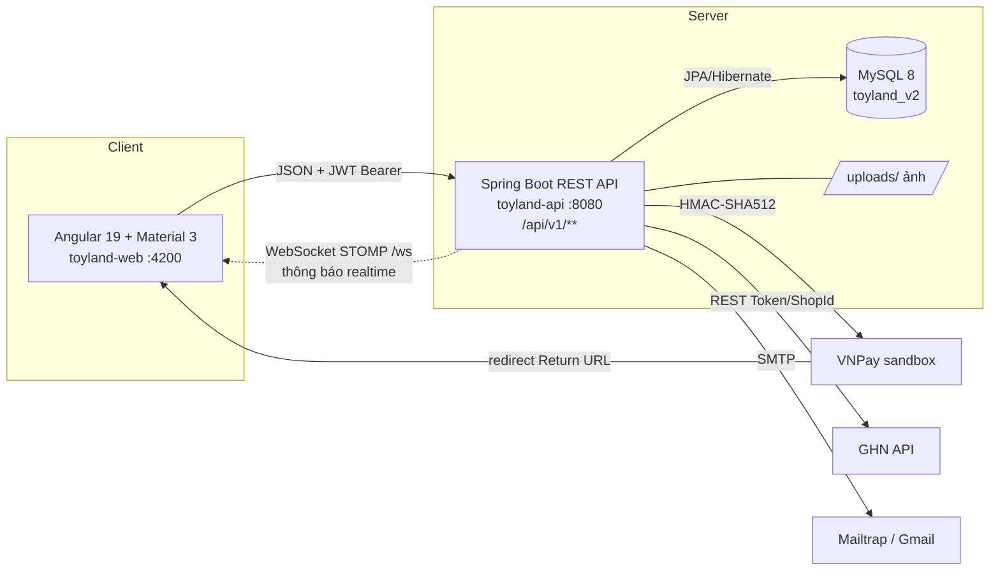
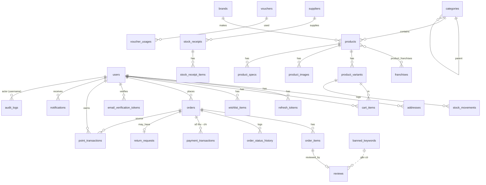
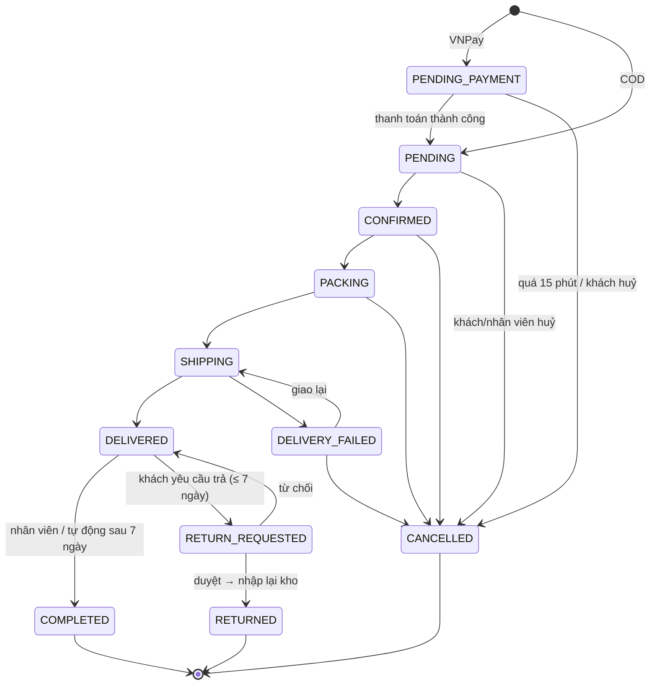

# ToyLand v2 – Tài liệu thiết kế

## 1. Kiến trúc tổng thể (SOA – Client/Server)

- **Backend** chia package theo nghiệp vụ (domain): `auth, user, catalog, wishlist, cart, promotion, order, payment, shipping, inventory, supplier, loyalty, review, report, notification, audit, media, common, config`. Mỗi domain gồm Entity – Repository – Service – Controller – DTO (Java record).
- `spring.jpa.open-in-view=false`: mọi chuyển đổi Entity → DTO nằm trong `@Transactional` service, controller chỉ nhận DTO.
- Lỗi trả về thống nhất `ErrorResponse {timestamp, status, code, message, path, details}` qua `GlobalExceptionHandler`.

## 2. Bảo mật

| Hạng mục | Thiết kế |
|---|---|
| Xác thực | JWT HS512 (jjwt 0.12). **Access token 15 phút** gửi qua header `Authorization: Bearer`. **Refresh token 7 ngày** lưu DB (`refresh_tokens`), mỗi lần làm mới sẽ thu hồi token cũ (rotation). |
| Phân quyền | `ADMIN` (toàn quyền), `STAFF` (đơn hàng, trả hàng, sản phẩm, kho, đánh giá, dashboard), `CUSTOMER`. Cấu hình trong `SecurityConfig`. |
| Mật khẩu | BCrypt. Sai 5 lần → khoá đăng nhập 15 phút. Quên mật khẩu: token 1 lần, hiệu lực 15 phút, đặt lại xong thu hồi mọi refresh token. |
| Xác nhận email | Tương tự `MustVerifyEmail` + middleware `verified` của Laravel. Đăng ký / đổi email → `users.email_verified_at = NULL`, sinh token ngẫu nhiên 256 bit (Base64URL), CSDL chỉ lưu **SHA-256** kèm email và hạn 24 giờ, link cũ bị huỷ khi gửi link mới. Khách chưa xác nhận bị chặn **đặt hàng, đánh giá** (`403 EMAIL_NOT_VERIFIED`). Gửi lại tối đa 1 lần/60 giây (`429`). Link hết hiệu lực nếu email đã đổi sau khi gửi. |
| Frontend | `authInterceptor` gắn token; nhận 401 → tự gọi `/auth/refresh` (chỉ 1 request dù nhiều API cùng lỗi) rồi gửi lại. Guard `authGuard`, `staffGuard`, `adminGuard`. |
| Dữ liệu cá nhân | Checkbox đồng ý điều khoản khi đăng ký (`consent_at`), cho phép xoá tài khoản (ẩn danh hoá, giữ đơn hàng) – theo NĐ 13/2023/NĐ-CP. |
| CORS | Chỉ cho phép `http://localhost:4200`; lộ header `Content-Disposition` để tải file Excel. |
| WebSocket | Handshake `/ws` mở, nhưng khung STOMP `CONNECT` bắt buộc JWT hợp lệ (`StompAuthInterceptor`); kênh `/topic/staff` chỉ ADMIN/STAFF được đăng ký; tin riêng gửi qua `/user/queue/notifications`. |
| Nhật ký | Mọi thao tác ghi của ADMIN/STAFF (tạo/sửa/xoá, đổi trạng thái, điều chỉnh kho/điểm, xuất báo cáo, đăng nhập) lưu `audit_logs` kèm IP. |

## 3. Cơ sở dữ liệu (33 bảng)

**Điểm thiết kế chính**

- **Biến thể tối đa 2 thuộc tính (kiểu Shopee):** `products.option1_name/option2_name` (vd *Kích thước*, *Màu sắc*) + `product_variants.option1/option2`. Mỗi biến thể có SKU, barcode, giá bán, giá gốc (gạch ngang), giá vốn, tồn kho, khối lượng, ảnh riêng, `version` (optimistic lock chống bán vượt tồn).
- **Thông tin đặc thù đồ chơi:** độ tuổi theo tháng (`age_min_months/age_max_months` → nhóm 0-12 tháng, 1-3, 3-6, 6-12, 12+), giới tính, chất liệu, xuất xứ, pin, cảnh báo chi tiết nhỏ, chứng nhận CR, đơn vị nhập khẩu, kích thước hộp (tính phí GHN).
- **Trường tổng hợp (denormalized)** trên `products`: `min_price, max_price, total_stock, sold_count, avg_rating, review_count, search_text` (không dấu để tìm kiếm) → danh sách/lọc nhanh, không cần join.
- **Đơn hàng lưu snapshot:** địa chỉ, tên sản phẩm, biến thể, SKU, ảnh, đơn giá tại thời điểm mua → sửa/xoá sản phẩm không ảnh hưởng đơn cũ (`order_items.product_id/variant_id` ON DELETE SET NULL).
- **Kho:** mọi thay đổi tồn đều ghi `stock_movements` (INITIAL, IMPORT, SALE, CANCEL, RETURN, ADJUSTMENT) với số dư sau thay đổi → truy vết được.
- **Xoá mềm** sản phẩm/người dùng đã phát sinh giao dịch (`deleted = 1`).
- **Nhà cung cấp** (`suppliers`): mã tự sinh `NCC-0001`, MST, liên hệ; `stock_receipts.supplier_id` (giữ cột chữ `supplier` cũ làm snapshot tên). Không xoá được NCC đã có phiếu nhập → chuyển *ngừng giao dịch*.
- **Giá vốn tại thời điểm bán** (`order_items.cost_price`) → báo cáo lợi nhuận gộp chính xác kể cả khi giá vốn biến thể thay đổi sau này.
- **Điểm thưởng:** số dư `users.points` + tổng tích luỹ `users.lifetime_points` (xét hạng, `CHECK points >= 0`); mọi biến động ghi `point_transactions` (EARN, REDEEM, REFUND, ADJUST) kèm số dư sau. Đơn lưu `points_used, points_discount, points_earned`. Cộng/trừ bằng câu `UPDATE ... WHERE points >= ?` nguyên tử → không âm điểm khi đặt 2 đơn cùng lúc.
- **Kiểm duyệt đánh giá:** `banned_keywords` lưu dạng không dấu; đánh giá chứa từ cấm → `reviews.flagged = 1, hidden = 1, flag_reason` chờ nhân viên duyệt.
- **Thông báo** (`notifications`): lưu DB để xem lại + đẩy realtime sau khi transaction commit.

## 4. Quy trình trạng thái đơn hàng

- **Trạng thái thanh toán** tách riêng: `UNPAID → PAID → REFUND_PENDING → REFUNDED` (+ `FAILED`). Đơn đã thu tiền mà bị huỷ / trả hàng chuyển *Chờ hoàn tiền* (không tự đánh dấu đã hoàn khi tiền chưa thực sự về tay khách); nhân viên chuyển tiền rồi ghi nhận, có thể hoàn nhiều đợt, hoàn đủ → *Đã hoàn tiền*.
- **Sổ thu – chi** (`payment_transactions`): mỗi lần tiền vào (VNPay, COD khi giao thành công, tiền mặt / chuyển khoản do nhân viên ghi nhận) hoặc tiền ra (hoàn tiền) là 1 dòng có `kind` PAYMENT/REFUND, người ghi nhận, mã giao dịch ngân hàng → đối soát theo kỳ, xuất Excel.
- Trừ kho ngay khi đặt hàng; huỷ → hoàn kho + trả lại lượt voucher; `DELIVERED` → cộng `sold_count`.
- Mỗi lần đổi trạng thái ghi `order_status_history` (ai, lúc nào, ghi chú) và gửi email cho khách (sau khi commit).
- `COMPLETED` → cộng điểm thưởng (theo hạng); huỷ / trả hàng → hoàn lại điểm đã dùng.
- Job định kỳ (`OrderScheduler`): mỗi phút huỷ đơn VNPay quá hạn; mỗi giờ hoàn tất đơn đã giao quá 7 ngày.

## 5. Tính giá & khuyến mãi

1. **Giá bán biến thể** (`price`), giá gốc `compare_at_price` nếu có.
2. **Chương trình khuyến mãi** (`campaigns`) tự động giảm % theo phạm vi: toàn shop / danh mục (gồm danh mục con) / thương hiệu / nhân vật / sản phẩm; nhiều chương trình trùng → lấy mức cao nhất; giá làm tròn xuống 1.000đ.
3. **Voucher** nhập ở bước thanh toán: `PERCENT` (có trần), `FIXED`, `FREESHIP`; điều kiện đơn tối thiểu, thời gian, tổng lượt, lượt/khách.
4. **Phí vận chuyển:** GHN (theo quận/phường, cân nặng, kích thước) hoặc phí cố định; **miễn phí từ 500.000đ**.
5. **Gói quà** +20.000đ kèm lời chúc trên thiệp.
6. **Điểm thưởng** (sau voucher): 1 điểm = 100đ, tối đa 50% giá trị hàng sau giảm giá. Tổng = tạm tính − giảm giá − trừ điểm + phí ship − giảm phí ship + gói quà.
7. **Tích điểm:** ⌊(tạm tính − giảm giá − trừ điểm) / 10.000⌋ × hệ số hạng (Thành viên 1.0 · Bạc 1.1 từ 500 · Vàng 1.25 từ 1.500 · Kim cương 1.5 từ 4.000 điểm tích luỹ).

## 6. Danh sách API (`/api/v1`)

| Nhóm | Endpoint |
|---|---|
| Auth | `POST /auth/register, /auth/login, /auth/refresh, /auth/logout, /auth/forgot-password, /auth/reset-password` · `POST /auth/verify-email` (public), `/auth/resend-verification` (đã đăng nhập) · `GET /auth/me` (có `emailVerified`) |
| Cửa hàng (public) | `GET /home, /categories, /brands, /franchises, /banners, /vouchers/available` · `GET /products` (q, category, brand, franchise, age, gender, minPrice, maxPrice, inStock, onSale, featured, sort, page, size) · `GET /products/facets, /products/suggest, /products/by-ids, /products/slug/{slug}, /products/{id}, /products/{id}/rating-summary, /products/{id}/reviews` |
| Vận chuyển | `GET /shipping/config, /shipping/provinces, /shipping/districts?provinceId, /shipping/wards?districtId` |
| Tài khoản | `GET/PUT /me` · `PUT /me/password` · `POST /me/delete` · `GET/POST /me/addresses` · `PUT/DELETE /me/addresses/{id}` · `PUT /me/addresses/{id}/default` · `GET /me/wishlist, /me/wishlist/ids` · `POST/DELETE /me/wishlist/{productId}` |
| Giỏ hàng | `GET/POST/DELETE /cart` · `PUT/DELETE /cart/{itemId}` · `POST /cart/merge` · `POST /cart/preview` (public) |
| Đặt hàng | `POST /checkout/quote` · `POST /orders` · `GET /orders, /orders/{id}` · `POST /orders/{id}/cancel, /pay, /return, /reorder` · `GET /orders/track` (public) · `POST /reviews` · `POST /uploads` |
| Thanh toán | `GET /payments/vnpay/return` · `GET /payments/vnpay/ipn` |
| Thanh toán & đối soát (ADMIN + STAFF) | `GET /admin/payments/summary, /admin/payments/transactions` (+ `/export` → .xlsx) · `GET /admin/payments/refund-queue, /admin/payments/cod-outstanding` · `GET /admin/payments/orders/{id}` · `POST /admin/payments/orders/{id}/collect` (ghi nhận đã thu) · `POST /admin/payments/orders/{id}/refund` (ghi nhận hoàn tiền) |
| Điểm thưởng & thông báo | `GET /account/points, /account/points/history` · `GET /notifications` (unreadOnly, page, size) · `GET /notifications/unread-count` · `PUT /notifications/{id}/read, /notifications/read-all` · WebSocket `/ws` → `/user/queue/notifications` |
| Quản trị | `/admin/dashboard` · `/admin/categories|brands|franchises` · `/admin/products` (+ `/{id}/status`) · `/admin/orders` (+ `/{id}/status`, `/{id}/note`, `/bulk-status`) · `/admin/returns/{id}/approve|reject` · `/admin/inventory` (+ `/adjust`, `/movements`, `/receipts`) · `/admin/vouchers|campaigns|banners` · `/admin/reviews` (+ `/{id}/visibility`, `/{id}/reply`) · `/admin/users` (+ `/{id}/unlock`, `/{id}/points` GET/POST, `/{id}/points/history`) · `/admin/suppliers` (+ `/options`) · `/admin/reviews/{id}/approve` · `/admin/banned-keywords` (+ `/rescan`) · `/admin/reports/sales|products|inventory|customers` (+ `/export` → .xlsx) · `/admin/audit-logs` |
| Phân quyền mở rộng | STAFF: thanh toán & đối soát, nhà cung cấp, duyệt đánh giá bị gắn cờ, thông báo. Chỉ ADMIN: báo cáo & xuất Excel, nhật ký hoạt động, từ khoá cấm, điểm thưởng khách hàng. |

Chi tiết tham số/ví dụ: Swagger <http://localhost:8080/swagger-ui.html> và Postman `postman/ToyLand-v2.postman_collection.json`.

## 7. Giao diện (tham chiếu MyKingdom, Shopee, Tiki)

- Material 3, màu chủ đạo đỏ – cam, font Nunito; responsive (thanh điều hướng dưới trên mobile, bộ lọc trượt, nút mua cố định).
- Header: tìm kiếm có gợi ý (sản phẩm, danh mục, thương hiệu – hỗ trợ không dấu), mega menu theo danh mục + độ tuổi + thương hiệu + nhân vật, giỏ hàng trượt có thanh tiến trình freeship.
- Chi tiết sản phẩm: chọn biến thể thông minh (tự điều chỉnh thuộc tính còn lại, gạch chéo tổ hợp hết hàng), hộp thông tin an toàn, tab mô tả/thông số, đánh giá có biểu đồ sao + ảnh.
- Trang quản trị: sidebar theo vai trò, dashboard biểu đồ (Chart.js), bảng Material có phân trang/lọc, form dùng chung cho CRUD.
